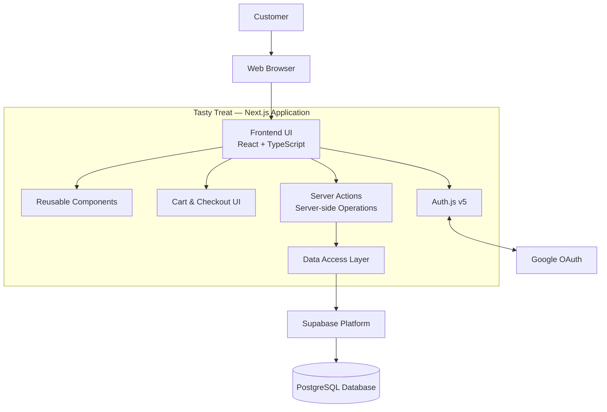
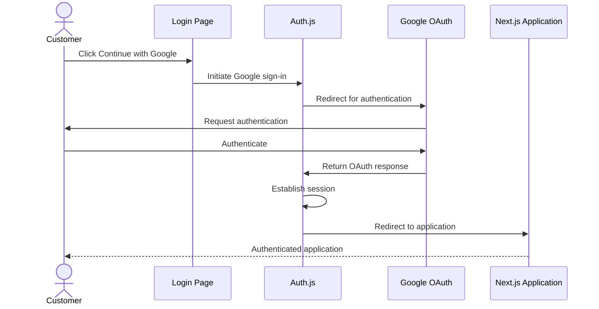
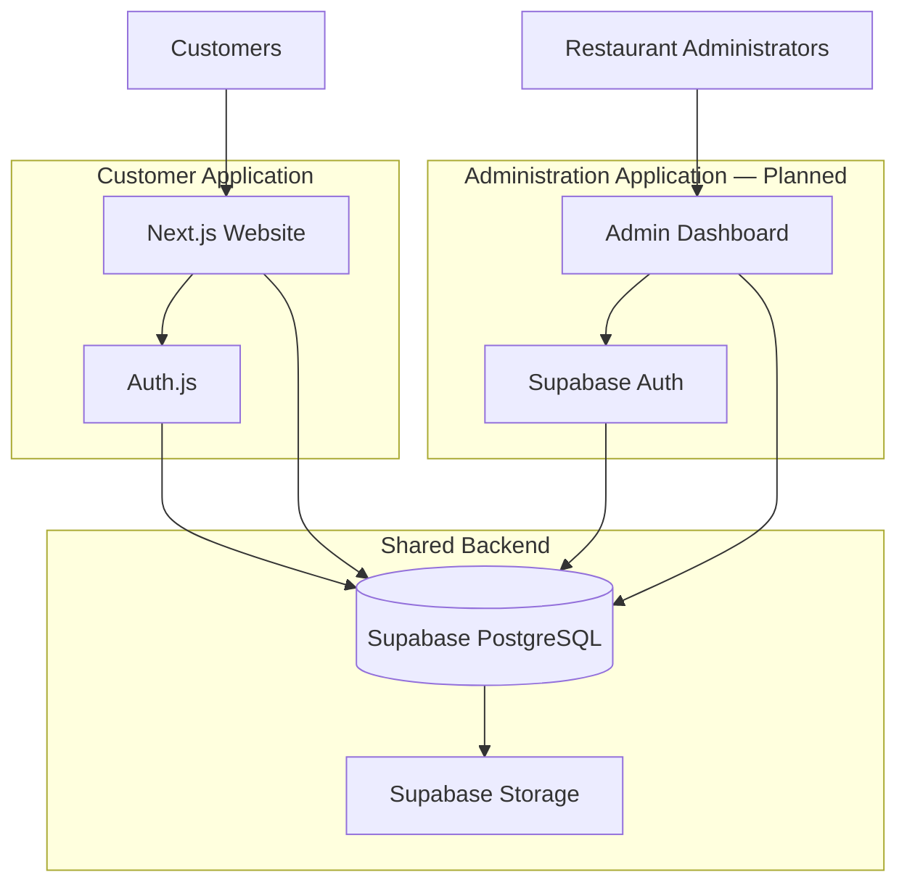

# 🍽️ Tasty Treat — Restaurant & Food Ordering Platform

A modern, full-stack restaurant website built with **Next.js, React, TypeScript and Supabase**.

Tasty Treat is a restaurant platform designed to provide customers with an intuitive food discovery and ordering experience. The application combines a responsive frontend, database-driven menu management, customer authentication and an architecture designed for future administrative and operational capabilities.

> **Project status:** Under active development.

---

## 📌 Overview

Tasty Treat aims to deliver a complete restaurant web experience, allowing customers to explore food categories, discover dishes, manage their cart, and place orders.

The project is being developed with an emphasis on:

- Modern frontend architecture using Next.js and React.
- Type-safe development with TypeScript.
- Database integration using Supabase and PostgreSQL.
- Authentication using Auth.js.
- Responsive user interface and reusable components.
- Secure server-side operations.
- Scalable application architecture.
- Containerization and CI/CD as planned engineering improvements.

## ✨ Features

### Implemented

- Responsive restaurant website interface.
- Dynamic menu data retrieved from Supabase.
- Menu browsing with cuisine filters.
- Custom category dropdown with themed scrollbar.
- Dish search functionality.
- Menu pagination.
- Reusable menu cards and UI components.
- Shopping cart functionality.
- Checkout interface.
- Order history interface.
- Customer login and registration interface.
- Google OAuth authentication using Auth.js.

### In development / planned

- Customer registration using email and password.
- Customer profile management.
- Automatic customer record creation and retrieval.
- Auth.js session integration throughout the application.
- Protected checkout and order routes.
- Server-side order creation and management.
- Secure customer-specific database access.
- Online payment gateway integration.
- Separate restaurant administration application.
- Administrative dashboards and operational analytics.
- AI-powered customer support chatbot enhancements.
- Docker containerization.
- GitHub Actions CI/CD pipeline.

_Features listed as planned are not represented as completed functionality._

---

## 🛠️ Technology Stack

| Technology     | Purpose                                   |
| -------------- | ----------------------------------------- |
| Next.js 16     | Full-stack React framework                |
| React 19       | Component-based user interface            |
| TypeScript 5   | Static typing                             |
| Supabase       | Backend platform and database integration |
| PostgreSQL     | Relational database                       |
| Auth.js v5     | Customer authentication                   |
| Google OAuth   | Social authentication                     |
| CSS            | Custom responsive styling                 |
| Git & GitHub   | Version control and collaboration         |
| Docker         | Planned containerization                  |
| GitHub Actions | Planned CI/CD automation                  |

### Development tools

- Visual Studio Code
- Node.js
- npm
- Supabase Dashboard
- Google Cloud Console

---

## 🏗️ System Architecture

The application follows a full-stack architecture with Next.js acting as the application layer between the customer-facing interface and backend services.

### High-level architecture



### Authentication architecture

The customer-facing application uses Auth.js with Google OAuth.



Customer-to-database record synchronization is a planned subsequent step.

### Database architecture

Supabase PostgreSQL provides relational data storage.

The current database includes:

| Table               | Purpose                             |
| ------------------- | ----------------------------------- |
| `customers`         | Customer information                |
| `cuisines`          | Cuisine information                 |
| `categories`        | Menu categories                     |
| `menu`              | Restaurant menu items               |
| `orders`            | Customer orders                     |
| `orderItems`        | Individual order items              |
| `tables`            | Restaurant table information        |
| `reservations`      | Reservation information             |
| `reservationTables` | Reservation and table relationships |
| `settings`          | Application settings                |

Row Level Security (RLS) is enabled across the database. Public SELECT policies currently exist for `cuisines`, `categories` and `menu`. Additional access policies are part of the security implementation roadmap.

---

## 📂 Project Structure

The application uses a feature-oriented structure within the Next.js App Router.

```text
tasty-treat-website/
│
├── public/
│
├── src/
│   └── app/
│       │
│       ├── _components/
│       │   ├── header.tsx
│       │   ├── footer.tsx
│       │   ├── cart-provider.tsx
│       │   └── ...
│       │
│       ├── _lib/
│       │   ├── actions.ts
│       │   ├── auth.ts
│       │   ├── data-service.ts
│       │   └── supabase.ts
│       │
│       ├── _styles/
│       │   └── globals.css
│       │
│       ├── api/
│       │   └── auth/
│       │       └── [...nextauth]/
│       │
│       ├── login/
│       ├── menu/
│       ├── cart/
│       ├── checkout/
│       ├── orders/
│       ├── reservations/
│       ├── about/
│       ├── contact/
│       │
│       ├── layout.tsx
│       └── page.tsx
│
├── .env.local
├── .gitignore
├── next.config.ts
├── package.json
└── README.md
```

_This is a representative project structure; update it as the implementation evolves._

### Code organization

- `_components`: Reusable application components.
- `_lib`: Authentication, database access and server-side application logic.
- `_styles`: Global styles and design system.
- `api/auth`: Auth.js authentication route handler.
- Route directories: Individual application pages and features.

---

## 🔐 Authentication & Security

The project uses Auth.js for customer-facing authentication.

### Customer application

- Google OAuth authentication.
- JWT-based session strategy planned for customer authentication.
- Email/password authentication planned.
- Customer records managed through Supabase.
- Customer-specific access controls planned.

### Database security

- Row Level Security enabled on all current public tables.
- Public menu reads restricted to approved tables.
- Customer-specific access policies to be implemented.
- Administrative access to be restricted to authorised users.
- Sensitive operations intended to execute server-side.

### Administrative application

A separate administration application is planned using Supabase Auth.

This keeps customer authentication and administrative authentication as separate application concerns.

**Security principles:**

- Never expose service-role credentials to the browser.
- Validate authentication and ownership on the server.
- Never trust client-provided prices or payment status.
- Restrict database access using appropriate permissions and RLS policies.

---

## ⚙️ Getting Started

### Prerequisites

- Node.js
- npm
- Git
- Supabase project
- Google Cloud OAuth credentials

### 1. Clone the repository

```bash
git clone YOUR_REPOSITORY_URL
```

### 2. Navigate to the project

```bash
cd tasty-treat-website
```

### 3. Install dependencies

```bash
npm install
```

### 4. Configure environment variables

Create a `.env.local` file in the project root.

```env
# Application
NEXTAUTH_URL=http://localhost:3000
NEXTAUTH_SECRET=your_auth_secret

# Google OAuth
AUTH_GOOGLE_ID=your_google_client_id
AUTH_GOOGLE_SECRET=your_google_client_secret

# Supabase
SUPABASE_URL=your_supabase_project_url
SUPABASE_KEY=your_supabase_publishable_or_anon_key
```

Use the appropriate Supabase key configured by your application. Never commit actual credentials or secrets to GitHub.

### 5. Configure Google OAuth

Configure the Google OAuth client in Google Cloud Console.

Local development redirect URI:

```text
http://localhost:3000/api/auth/callback/google
```

### 6. Run the development server

```bash
npm run dev
```

Open:

```text
http://localhost:3000
```

---

## 🚀 Development Roadmap

The project is being developed incrementally.

| Phase | Scope                                     | Status                                |
| ----- | ----------------------------------------- | ------------------------------------- |
| 1     | Frontend and UI development               | In progress / existing implementation |
| 2     | Supabase database integration             | Implemented for menu reads            |
| 3     | Customer authentication                   | In progress                           |
| 4     | Customer profile and database integration | Planned                               |
| 5     | Secure order processing                   | Planned                               |
| 6     | Payment integration                       | Planned                               |
| 7     | Administration application                | Planned                               |
| 8     | AI chatbot enhancements                   | Planned                               |
| 9     | Docker and CI/CD                          | Planned                               |
| 10    | Production deployment                     | Planned                               |

---

## 🧪 Quality & Engineering Practices

The development approach aims to follow professional software engineering practices:

- Component-based architecture.
- Type-safe application development.
- Separation of UI, data access and server-side operations.
- Server-side input validation.
- Database access control.
- Version control using Git.
- Incremental feature development.
- Environment-based configuration.
- Automated build and deployment pipelines (planned).

---

## 🗺️ Future Architecture

The longer-term vision is to expand Tasty Treat into two connected applications.



The future administration application will support restaurant operations, menu management, order management and business analytics.

---

## 👨‍💻 Development

Tasty Treat is an independent portfolio project focused on building a production-oriented full-stack restaurant application.

The project is intended to demonstrate practical skills in:

- Full-stack web development.
- React and Next.js application architecture.
- TypeScript.
- Authentication and authorization.
- Relational database design.
- Backend integration.
- Application security.
- Deployment and DevOps practices.

---

## 📄 License

License information will be added when the project licensing decision is finalised.

---

**Tasty Treat — Good food. Great moments.** 🍽️
