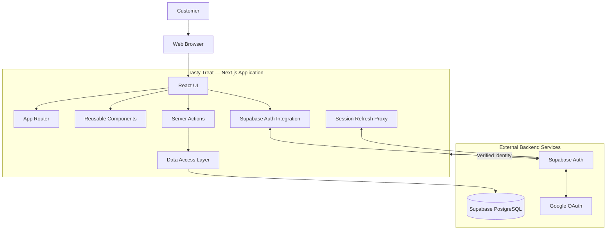
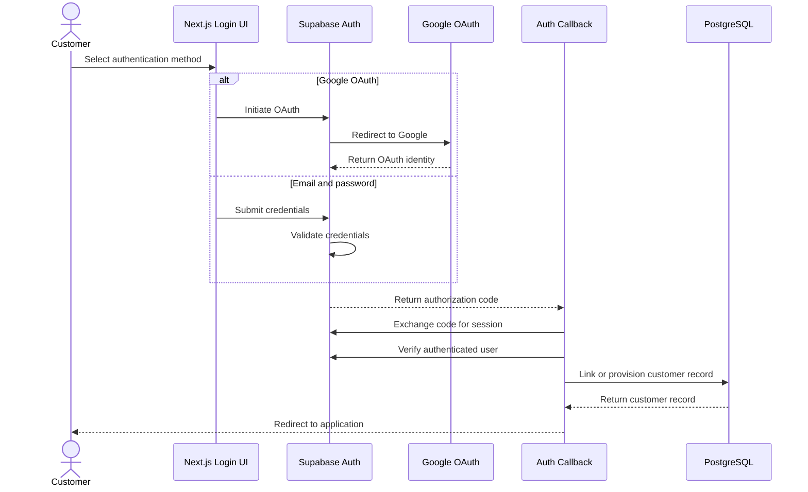
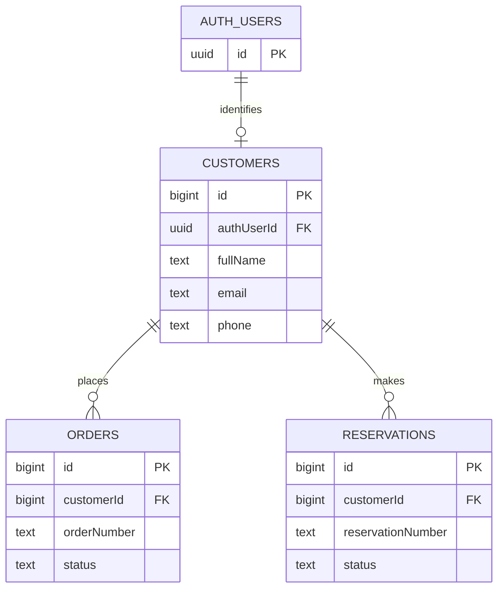
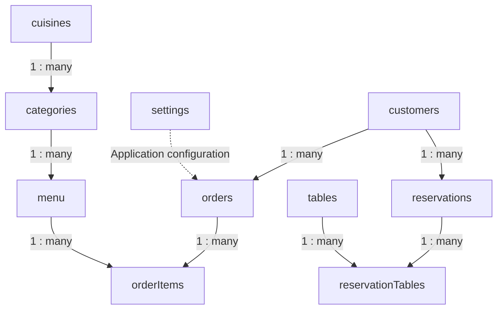
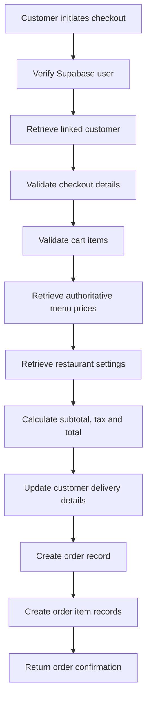
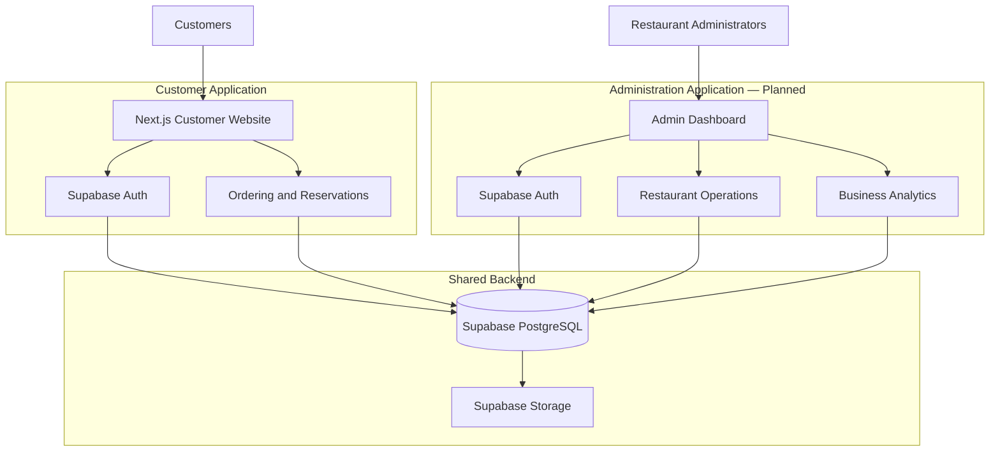

# Tasty Treat

### Restaurant Ordering & Management Platform

**A full-stack restaurant application built to deliver a seamless digital dining experience—from menu discovery and customer authentication to checkout and order management.**

<p align="center">
  <strong>Next.js 16 · React 19 · TypeScript · Supabase · PostgreSQL</strong>
</p>

---

## Overview

Tasty Treat is a modern restaurant web application designed to bring the core digital dining experience into one cohesive platform.

The customer-facing application enables users to discover menu items, explore food categories, search for dishes, manage a shopping cart, authenticate securely, and place orders.

The platform is being developed with a focus on maintainable architecture, reliable data handling, secure server-side operations, and a foundation that can support future restaurant administration and operational analytics.

Rather than treating the application as a collection of standalone pages, the project approaches restaurant ordering as an integrated product workflow.

### Product objectives

- Deliver an intuitive, responsive food-ordering experience.
- Provide a structured and database-driven restaurant menu.
- Support secure customer authentication and account management.
- Implement reliable checkout and order-processing workflows.
- Maintain clear separation between presentation, application logic, and data access.
- Establish a foundation for restaurant administration and business intelligence.

**Project status:** Active development.

---

## Product Capabilities

The following distinguishes existing implementation from functionality that is still being developed.

### Implemented

- Responsive restaurant website interface.
- Dynamic menu retrieval from Supabase.
- Cuisine and category-based menu browsing.
- Dish search functionality.
- Menu pagination.
- Reusable menu cards and interface components.
- Shopping cart functionality.
- Checkout interface.
- Order history interface.
- Customer login and registration interfaces.
- Supabase Auth integration.
- Google OAuth authentication integration.
- Email/password authentication integration.
- Password recovery flow integration.
- Supabase customer identity linkage.
- Server-side checkout validation.
- Server-side order creation logic.

_Authentication and order workflows have been integrated into the application. End-to-end production readiness and external payment processing remain separate validation tasks._

### In development

- End-to-end authentication and account lifecycle testing.
- Customer profile management.
- Customer-specific data access policies.
- Reservation workflow integration.
- Expanded order lifecycle management.
- Improved error handling and transaction reliability.

### Planned

- Dedicated restaurant administration application.
- Administrative dashboard and operational analytics.
- Menu and inventory management.
- Advanced order management.
- Online payment gateway integration.
- AI-powered customer support enhancements.
- Docker-based deployment workflow.
- GitHub Actions CI/CD pipeline.
- Production deployment and monitoring.

---

## Technology Stack

| Technology      | Responsibility                                 |
| --------------- | ---------------------------------------------- |
| Next.js 16      | Full-stack application framework and routing   |
| React 19        | Component-based user interface                 |
| TypeScript      | Static typing and maintainability              |
| Supabase Auth   | Customer authentication and session management |
| Supabase        | Backend platform and database connectivity     |
| PostgreSQL      | Relational data persistence                    |
| `@supabase/ssr` | Browser and cookie-based server clients        |
| Google OAuth    | Social authentication provider                 |
| CSS             | Responsive styling and presentation            |
| Git & GitHub    | Version control and source management          |
| Docker          | Planned containerization                       |
| GitHub Actions  | Planned CI/CD automation                       |

### Development environment

- Visual Studio Code
- Node.js
- npm
- Supabase Dashboard
- Google Cloud Console

---

## System Architecture

The application uses Next.js as its application layer, connecting the customer-facing interface to authentication services and the relational database.

### High-level architecture



### Architectural responsibilities

| Layer             | Responsibility                                      |
| ----------------- | --------------------------------------------------- |
| Presentation      | Customer-facing pages, components, and interactions |
| Routing           | Next.js App Router and server-rendered pages        |
| Authentication    | Supabase Auth and session handling                  |
| Application logic | Server Actions and server-side validation           |
| Data access       | Supabase database operations                        |
| Persistence       | PostgreSQL relational data model                    |

This separation helps keep UI concerns distinct from authentication, business rules, and database operations.

---

## Authentication Architecture

Customer authentication is handled by Supabase Auth.

The application supports Google OAuth and email/password authentication, with password recovery and session handling integrated into the Next.js application.

### Authentication flow



### Customer identity model

The application maintains a distinction between the Supabase Auth identity and the application's customer record.

- Supabase Auth identifies the authenticated user using a UUID.
- The `customers` table maintains the application's existing numeric customer ID.
- The `authUserId` field links the customer record to the corresponding Supabase Auth user.
- Existing customer IDs remain the application-level references used by orders and reservations.

This separation preserves existing relational relationships while introducing Supabase-managed authentication.



_The Auth Users entity represents Supabase's managed authentication records, not a separately maintained application table._

### Session management

The application uses Supabase's browser and server client integrations.

- Browser authentication uses the publishable key.
- Server-side authentication uses cookie-based session handling.
- The Next.js proxy refreshes authentication cookies.
- Server-side identity verification uses `supabase.auth.getUser()`.

The proxy handles session refresh; authorization decisions must still be enforced by the relevant server-side operations.

---

## Database Architecture

Supabase PostgreSQL provides relational storage for the application's restaurant and customer data.

The schema separates restaurant catalogue data, customer information, order processing, reservations, and application settings.

### Core entities

| Table               | Responsibility                               |
| ------------------- | -------------------------------------------- |
| `customers`         | Customer profiles and authentication linkage |
| `cuisines`          | Cuisine definitions                          |
| `categories`        | Menu categories associated with cuisines     |
| `menu`              | Restaurant dishes and availability           |
| `orders`            | Customer order records                       |
| `orderItems`        | Individual items associated with an order    |
| `reservations`      | Customer reservation records                 |
| `tables`            | Restaurant table information                 |
| `reservationTables` | Reservation-to-table relationships           |
| `settings`          | Restaurant operating and pricing settings    |

### Relational model



### Data integrity considerations

- Numeric customer IDs remain the application-level customer identifiers.
- Supabase Auth UUIDs are linked separately through `customers.authUserId`.
- Orders reference customers through `customerId`.
- Order items reference both orders and menu items.
- Reservation-table relationships are represented through a junction table.
- Menu prices and availability are retrieved from the database during order validation.
- Checkout totals are calculated server-side using database-backed pricing and restaurant settings.

---

## Order Processing

Checkout is designed around server-side validation rather than trusting values submitted by the browser.

### Order creation flow



### Checkout safeguards

- Authenticated user verification on the server.
- Customer ownership resolved through the Supabase Auth UUID.
- Input validation for customer and delivery information.
- Cart item and quantity validation.
- Duplicate item detection.
- Menu availability verification.
- Authoritative price retrieval from PostgreSQL.
- Server-side calculation of order totals.
- Restaurant minimum-order and delivery-fee validation.
- Order creation linked to the existing numeric customer ID.

_The current order creation implementation uses best-effort cleanup if order-item insertion fails. Full transactional processing and payment reconciliation are future hardening tasks._

---

## Security Architecture

Security is treated as an application-wide responsibility rather than an authentication-only concern.

### Current security approach

- Supabase Auth manages customer identity and authentication sessions.
- Server-side routes and operations verify authenticated users.
- Customer records are linked using verified authentication identities.
- Checkout validates user input and database-backed prices on the server.
- Privileged Supabase credentials are kept in server-only code.
- Public database access is restricted through configured database policies.

### Credential separation

The application uses two categories of Supabase credentials.

| Credential                 | Usage                                   | Exposure               |
| -------------------------- | --------------------------------------- | ---------------------- |
| `NEXT_PUBLIC_SUPABASE_KEY` | Browser and cookie-based server clients | Public publishable key |
| `SUPABASE_KEY`             | Privileged server-side database client  | Server-only secret key |

The secret key must never be exposed through client components, browser requests, public environment variables, or committed source code.

### Database access considerations

The privileged server-side Supabase client bypasses Row Level Security.

Consequently:

- Privileged database operations must remain inside trusted server-side code.
- Server-side operations must verify user identity and resource ownership before accessing customer-specific records.
- RLS policies must be appropriately configured for any direct client-side database access.
- Authentication alone does not automatically grant application-level administrative privileges.

Customer and administrator authorization must be explicitly enforced as those capabilities are introduced.

---

## Project Structure

The application follows the Next.js App Router convention, with reusable components and shared application logic grouped under the application directory.

```text

tasty-treat-website/
│
├── public/
│
├── src/
│   ├── proxy.ts
│   │
│   └── app/
│       ├── _components/
│       │   ├── cart-bottom-bar.tsx
│       │   ├── cart-provider.tsx
│       │   ├── chatbot.tsx
│       │   ├── CheckoutForm.tsx
│       │   ├── feature-strip.tsx
│       │   ├── footer.tsx
│       │   ├── Header.tsx
│       │   ├── HeaderClient.tsx
│       │   ├── hero.tsx
│       │   ├── menu-card.tsx
│       │   ├── menuClient.tsx
│       │   ├── page-hero.tsx
│       │   └── section-title.tsx
│       │
│       ├── _lib/
│       │   ├── actions.ts
│       │   ├── apiAuth.ts
│       │   ├── data-service.ts
│       │   ├── supabase-client.ts
│       │   ├── supabase-server.ts
│       │   └── supabase.ts
│       │
│       ├── _styles/
│       │   └── globals.css
│       │
│       ├── api/
│       │   └── chatbot/
│       │       └── menu/
│       │           └── route.ts
│       │
│       ├── auth/
│       │   └── callback/
│       │       └── route.ts
│       │
│       ├── about/
│       │   └── page.tsx
│       ├── cart/
│       │   └── page.tsx
│       ├── checkout/
│       │   ├── page.tsx
│       │   └── success/
│       │       └── page.tsx
│       ├── contact/
│       │   └── page.tsx
│       ├── forgot-password/
│       │   └── page.tsx
│       ├── login/
│       │   └── page.tsx
│       ├── menu/
│       │   └── page.tsx
│       ├── orders/
│       │   └── page.tsx
│       ├── reservations/
│       │   └── page.tsx
│       ├── reset-password/
│       │   └── page.tsx
│       │
│       ├── favicon.ico
│       ├── layout.tsx
│       ├── not-found.tsx
│       └── page.tsx
│
├── .env.local
├── .gitignore
├── next.config.ts
├── package.json
└── README.md

```

_Representative structure based on the current application organization. Additional components and files may exist._

### Code organization

| Directory / File          | Responsibility                             |
| ------------------------- | ------------------------------------------ |
| `_components`             | Reusable UI components                     |
| `_lib/actions.ts`         | Server-side application actions            |
| `_lib/data-service.ts`    | Data retrieval and validation helpers      |
| `_lib/supabase.ts`        | Privileged server-side Supabase client     |
| `_lib/supabase-client.ts` | Browser Supabase client                    |
| `_lib/supabase-server.ts` | Cookie-based server Supabase client        |
| `auth/callback`           | OAuth and authentication callback handling |
| `proxy.ts`                | Authentication cookie/session refresh      |

---

## Getting Started

### Prerequisites

- Node.js
- npm
- Git
- Supabase project
- Google Cloud OAuth credentials for Google sign-in

### 1. Clone the repository

```bash
git clone YOUR_REPOSITORY_URL
```

### 2. Navigate to the project

```bash
cd tasty-treat-website
```

### 3. Install dependencies

```bash
npm install
```

### 4. Configure environment variables

Create `.env.local` in the project root.

```env
# Supabase project configuration
SUPABASE_URL=your_supabase_project_url
SUPABASE_KEY=your_supabase_secret_key

# Public Supabase configuration
NEXT_PUBLIC_SUPABASE_URL=your_supabase_project_url
NEXT_PUBLIC_SUPABASE_KEY=your_supabase_publishable_key
```

**Important:**

- `SUPABASE_KEY` is a server-only secret key used by privileged server-side operations.
- `NEXT_PUBLIC_SUPABASE_KEY` is the publishable key used by browser and cookie-based server clients.
- Never commit `.env.local` or actual credentials to version control.
- Do not use the secret key in client-side code.

### 5. Configure Supabase Authentication

In the Supabase Dashboard:

1. Enable the required authentication providers.
2. Configure Google OAuth credentials if Google sign-in is required.
3. Configure the application Site URL.
4. Add the local development callback URL to the allowed redirect URLs.

Local callback URL:

```text
http://localhost:3000/auth/callback
```

For Google OAuth, configure the Supabase-provided callback URI in Google Cloud Console.

### 6. Run the development server

```bash
npm run dev
```

Open:

```text
http://localhost:3000
```

### 7. Production build

```bash
npm run build
```

To run the production build locally:

```bash
npm start
```

---

## Engineering Practices

The project follows an incremental engineering approach focused on maintainability, separation of concerns, and reliable application behaviour.

### Current practices

- Component-based UI architecture.
- TypeScript-based application development.
- Next.js App Router conventions.
- Separation of presentation and server-side logic.
- Reusable data-access functions.
- Server-side input validation.
- Database-backed pricing and availability validation.
- Environment-based configuration.
- Version control using Git and GitHub.
- Supabase authentication and session management.

### Planned engineering improvements

- Automated test coverage.
- Stronger database transaction boundaries.
- Expanded authorization policies.
- Structured application logging.
- Docker containerization.
- GitHub Actions build and deployment pipelines.
- Production monitoring and error reporting.

---

## Development Roadmap

| Phase | Deliverable                               | Status                                  |
| ----- | ----------------------------------------- | --------------------------------------- |
| 1     | Customer-facing UI and responsive layouts | Implemented                             |
| 2     | Supabase database integration             | Implemented for current data operations |
| 3     | Customer authentication integration       | Integrated; validation ongoing          |
| 4     | Customer profile and account management   | In development                          |
| 5     | Order processing and lifecycle hardening  | In development                          |
| 6     | Online payment integration                | Planned                                 |
| 7     | Restaurant administration application     | Planned                                 |
| 8     | Operational analytics and reporting       | Planned                                 |
| 9     | Advanced AI customer support              | Planned                                 |
| 10    | Docker and CI/CD                          | Planned                                 |
| 11    | Production deployment and monitoring      | Planned                                 |

---

## Future Platform Architecture

The longer-term direction is to evolve Tasty Treat into two connected application experiences sharing a common backend.

1. **Customer application:** Menu discovery, authentication, ordering, reservations, and customer account management.
2. **Administration application:** Restaurant operations, menu management, order management, reservations, and business analytics.

### Target architecture



The administration application is a planned extension, not a currently completed product component.

Customer and administrative authorization will be separated through explicit role-based access controls and server-side permission checks.

---

## Business Value

Tasty Treat is designed around practical restaurant operations rather than a purely demonstrative interface.

The platform's intended value includes:

- **Customer experience:** A straightforward digital journey from menu discovery to order confirmation.
- **Operational efficiency:** Centralized menu, order, and reservation data.
- **Data consistency:** Relational relationships between customers, orders, menu items, and reservations.
- **Extensibility:** A backend foundation for administration and operational reporting.
- **Maintainability:** Clear application boundaries and reusable components.

The architecture is intended to support future customization for restaurant-specific workflows and operational requirements.

---

## Project Focus

Tasty Treat is an independently developed full-stack product project intended to demonstrate practical software engineering and product development capabilities.

It brings together:

- Frontend engineering with React and Next.js.
- Type-safe development with TypeScript.
- Authentication and session management.
- Relational database design.
- Server-side business logic.
- Checkout and order-processing workflows.
- Application security considerations.
- System architecture and future deployment planning.

The project is actively evolving, with a focus on building functionality incrementally and validating each layer before expanding the platform.

---

## License

License information will be added when the project's licensing decision is finalized.

---

<p align="center">
  <strong>Tasty Treat</strong><br/>
  Good food. Great moments.
</p>
