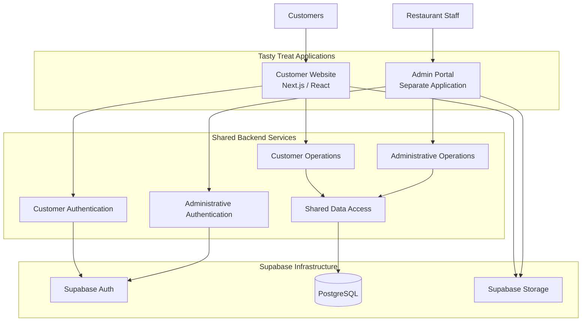
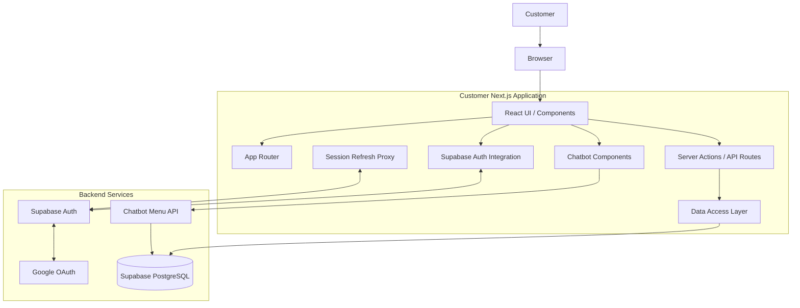
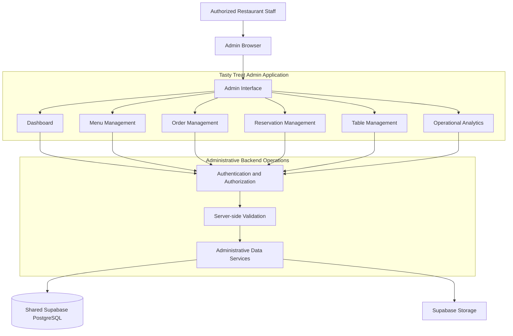
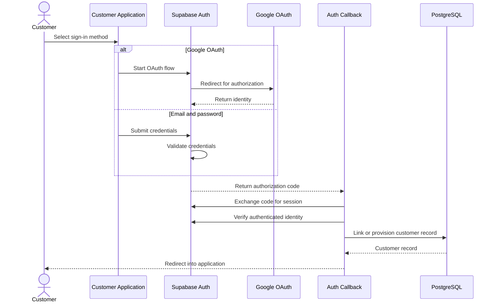
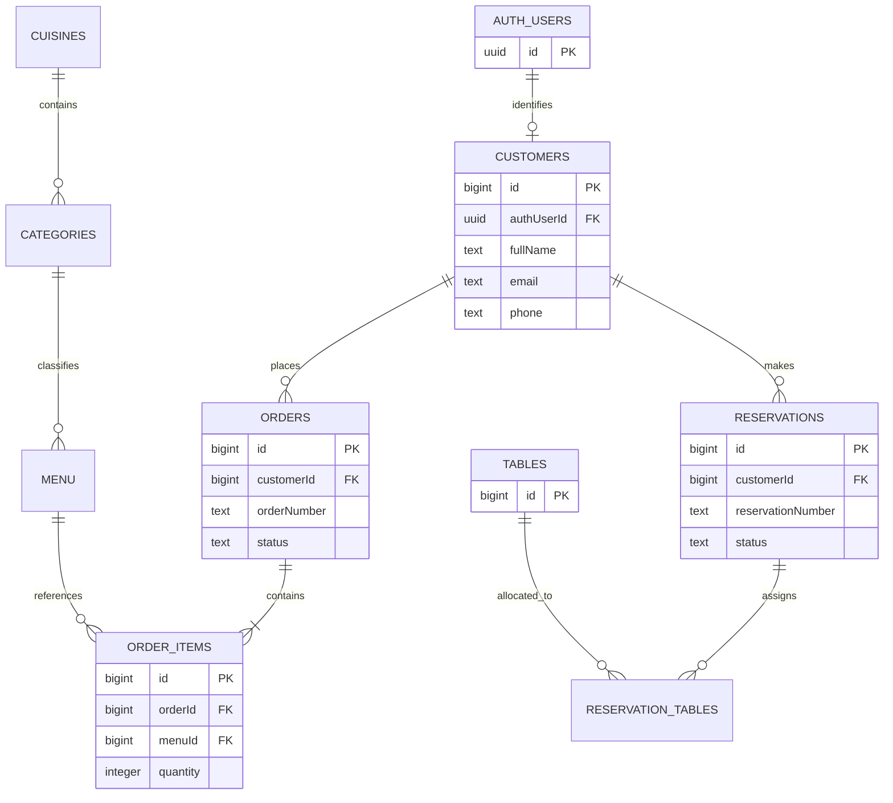
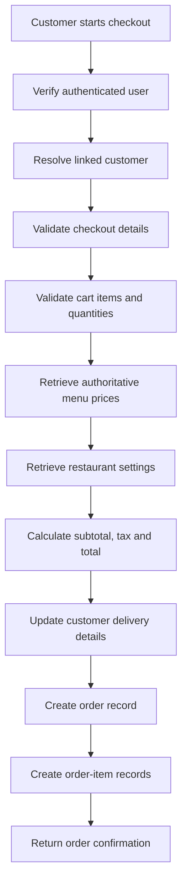
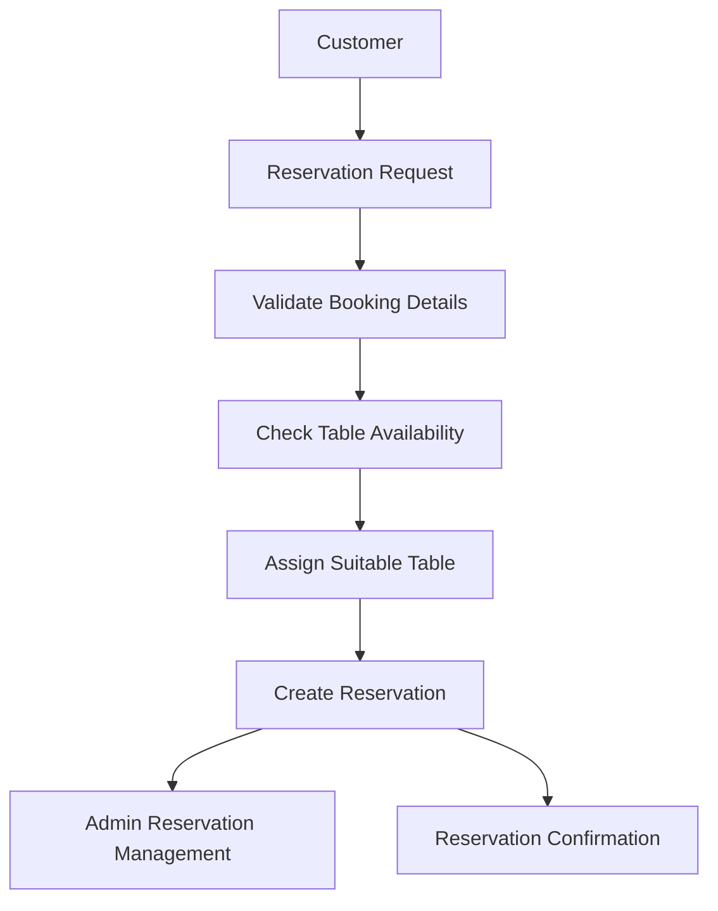
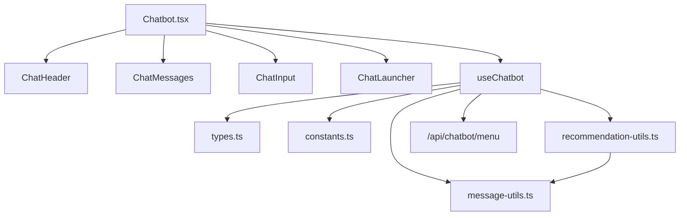
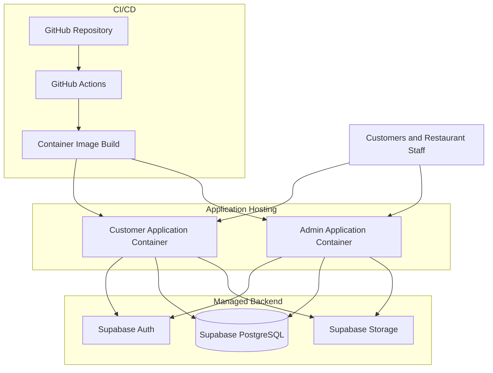

# Tasty Treat

### Restaurant Ordering & Management Platform

**Tasty Treat** is a full-stack restaurant platform comprising a customer-facing ordering application and a dedicated restaurant administration application. The platform is designed to support the complete digital restaurant experience, from menu discovery and customer authentication to order processing, reservations and restaurant operations.

The system is built around a shared backend architecture using Next.js, React, TypeScript, Supabase and PostgreSQL, with clear boundaries between customer-facing functionality and administrative operations.

The project emphasizes maintainable application architecture, secure authentication, database-backed business operations, server-side validation, and extensibility for future production deployment.

> **Development status:** Active development. Features are identified according to their implementation status. The presence of an integrated feature does not necessarily indicate production readiness. Payment processing, comprehensive operational verification, deployment and further security hardening remain ongoing work.

---

## Table of Contents

1. [Platform Overview](#platform-overview)
2. [Applications](#applications)
3. [Product Capabilities](#product-capabilities)
4. [Technology Stack](#technology-stack)
5. [System Architecture](#system-architecture)
6. [Customer Application Architecture](#customer-application-architecture)
7. [Administration Application Architecture](#administration-application-architecture)
8. [Authentication and Identity](#authentication-and-identity)
9. [Database Architecture](#database-architecture)
10. [Order Processing](#order-processing)
11. [Reservation Management](#reservation-management)
12. [Chatbot Architecture](#chatbot-architecture)
13. [Security Architecture](#security-architecture)
14. [Repository Organization](#repository-organization)
15. [Local Development](#local-development)
16. [Engineering Practices and Deployment](#engineering-practices-and-deployment)
17. [Demo Environments](#demo-environments)
18. [Roadmap](#roadmap)
19. [Ownership and Intellectual Property](#ownership-and-intellectual-property)
20. [License](#license)

---

## Platform Overview

Tasty Treat is organized around two complementary applications sharing a common backend and relational data model.

| Application             | Primary responsibility                                                                                          |
| ----------------------- | --------------------------------------------------------------------------------------------------------------- |
| Customer Website        | Customer registration, menu discovery, ordering, checkout, reservations and account functionality               |
| Restaurant Admin Portal | Restaurant operations, dashboard, menu administration, order management, reservations and operational analytics |
| Shared Backend          | Authentication, database persistence, server-side business operations and shared application data               |

The applications have separate user experiences and authorization requirements while using common backend infrastructure.

### Platform objectives

- Provide customers with a cohesive online restaurant experience.
- Support restaurant operations through a dedicated administrative interface.
- Maintain consistent data across customer and administrative workflows.
- Enforce authentication, authorization and data ownership at the server and database layers.
- Establish a maintainable foundation for future integrations and production deployment.

---

## Applications

### 1. Tasty Treat — Customer Website

The customer application provides the public-facing restaurant experience.

**Primary functionality**

- Responsive restaurant website.
- Database-driven menu discovery.
- Cuisine and category exploration.
- Menu search and pagination.
- Shopping cart management.
- Customer registration and authentication.
- Google OAuth and email/password authentication.
- Password recovery.
- Checkout and server-side order creation.
- Customer order history.
- Reservation-related experiences.
- Rule-based chatbot interface with menu recommendations.

**Application entry point**

`/`

**Future deployment URL:** `https://your-customer-domain.example`

### 2. Tasty Treat — Admin Portal

The administration application is a separate interface intended for authorized restaurant personnel.

Its architectural responsibilities include:

- Restaurant operations dashboard.
- Menu and category administration.
- Order management.
- Reservation management.
- Table and seating administration.
- Customer information management, subject to authorization.
- Operational statistics and analytics.
- Restaurant configuration and settings.

The administration application must use a separate administrative authorization model. Customer authentication alone must never grant access to administrative functionality.

**Future deployment URL:** `https://your-admin-domain.example`

> Administrative functionality and deployment status should be assessed against the current admin application implementation. Planned capabilities are not represented as verified production functionality.

---

## Product Capabilities

### Customer application

| Capability                                            | Status                                   |
| ----------------------------------------------------- | ---------------------------------------- |
| Responsive customer website                           | Implemented                              |
| Supabase-backed menu retrieval                        | Implemented                              |
| Cuisine/category filtering                            | Implemented                              |
| Menu search and pagination                            | Implemented                              |
| Cart interactions                                     | Implemented                              |
| Checkout UI                                           | Implemented                              |
| Order history UI                                      | Implemented                              |
| Supabase Auth integration                             | Integrated                               |
| Google OAuth                                          | Integrated                               |
| Email/password authentication                         | Integrated                               |
| Password recovery                                     | Integrated                               |
| Customer identity linkage                             | Integrated                               |
| Server-side checkout validation                       | Implemented                              |
| Server-side order creation                            | Implemented                              |
| Menu-focused chatbot interface/API                    | Implemented; further development planned |
| Chatbot component modularization                      | Implemented                              |
| Chatbot conversation logic extraction                 | Implemented                              |
| Customer profile/account management                   | In progress                              |
| Reservation workflow integration                      | In progress                              |
| Order lifecycle and transaction reliability hardening | In progress                              |

### Administration application

| Capability                          | Status                              |
| ----------------------------------- | ----------------------------------- |
| Separate administration application | Provided as a companion application |
| Operational dashboard               | Implementation to be verified       |
| Menu administration                 | Implementation to be verified       |
| Order management                    | Implementation to be verified       |
| Reservation management              | Implementation to be verified       |
| Table management                    | Implementation to be verified       |
| Operational analytics               | Implementation to be verified       |
| Administrative authorization        | Requires independent verification   |

### Platform-wide planned capabilities

- Payment gateway integration.
- Stronger transactional guarantees.
- Expanded reservation workflow.
- Inventory and stock management.
- Advanced customer assistance.
- Docker-based deployment.
- GitHub Actions CI/CD.
- Production monitoring and observability.

---

## Technology Stack

### Customer application

| Technology      | Responsibility                             |
| --------------- | ------------------------------------------ |
| Next.js 16      | Full-stack framework and App Router        |
| React 19        | Component-based user interface             |
| TypeScript      | Static typing                              |
| Tailwind CSS 4  | Responsive styling                         |
| Supabase        | Backend services and database connectivity |
| Supabase Auth   | Authentication and session management      |
| PostgreSQL      | Relational persistence                     |
| `@supabase/ssr` | Cookie-aware browser and server clients    |
| Google OAuth    | Federated authentication                   |
| Git / GitHub    | Version control                            |

### Administration application

The administration application is maintained as a separate application with its own interface and operational boundaries.

Its exact framework versions, dependencies and implementation-specific technologies should be documented from its current package manifest rather than assumed to be identical to the customer application.

### Infrastructure and engineering

| Technology          | Responsibility                       |
| ------------------- | ------------------------------------ |
| Docker              | Planned application containerization |
| GitHub Actions      | Planned automated checks and CI/CD   |
| Supabase Storage    | Application asset storage            |
| Supabase PostgreSQL | Shared relational data               |
| GitHub              | Source control and collaboration     |

---

## System Architecture

The platform follows a two-application architecture backed by shared services.

The customer website and administration application have separate presentation and access-control boundaries. Shared backend infrastructure provides centralized persistence and consistent business data.

### High-level architecture



### Architectural boundaries

| Layer                  | Responsibility                             |
| ---------------------- | ------------------------------------------ |
| Presentation           | Customer and administrative interfaces     |
| Routing                | Application routing and page composition   |
| Authentication         | Identity verification and session handling |
| Authorization          | Role and resource access enforcement       |
| Application operations | Business rules and server-side validation  |
| Data access            | Database queries and data retrieval        |
| Persistence            | PostgreSQL relational data                 |
| Storage                | Application images and uploaded assets     |

---

## Customer Application Architecture

The customer application uses the Next.js App Router with React components and server-side application operations.



### Customer application responsibilities

- Render customer-facing pages and components.
- Handle authenticated customer interactions.
- Validate submitted data through trusted server-side operations.
- Retrieve menu and restaurant information.
- Create customer orders using database-backed values.
- Maintain customer-specific data access restrictions.
- Provide navigation and customer assistance.

---

## Administration Application Architecture

The administration application is designed as an independent operational interface.

Its architecture separates staff-facing screens from administrative business operations and shared persistence.



Administrative operations must verify the staff member's permissions on the server. Hiding interface elements is not an authorization mechanism.

---

## Authentication and Identity

Supabase Auth manages customer identity and authentication.

The customer application integrates:

- Google OAuth.
- Email/password authentication.
- Password recovery.
- Cookie-based session handling.
- Authentication identity linkage to application customer records.

### Customer authentication flow



### Customer identity model

Authentication identity and application customer identity are maintained separately.

- Supabase Auth identifies a user with a UUID.
- The `customers` table retains its numeric customer ID.
- `customers.authUserId` links the customer record to the Supabase Auth identity.
- Existing customer IDs remain application-level references for orders and reservations.

### Administrative identity

Administrative access must be independently authorized.

Recommended controls include:

- Staff identity verification.
- Explicit administrative roles.
- Server-side permission checks.
- Resource-level authorization.
- Restricted access to sensitive operational data.
- Audit logging for important administrative actions.

---

## Database Architecture

Supabase PostgreSQL provides relational persistence for restaurant, customer, ordering, reservation and configuration data.

### Core entities

| Entity              | Responsibility                                 |
| ------------------- | ---------------------------------------------- |
| `customers`         | Customer records and authentication linkage    |
| `cuisines`          | Cuisine definitions                            |
| `categories`        | Menu categories associated with cuisines       |
| `menu`              | Dishes, pricing and availability               |
| `orders`            | Customer order records                         |
| `orderItems`        | Items associated with an order                 |
| `reservations`      | Customer reservation records                   |
| `tables`            | Restaurant table information                   |
| `reservationTables` | Reservation-to-table relationships             |
| `settings`          | Restaurant operating and pricing configuration |

### Relationship overview



`AUTH_USERS` represents Supabase-managed authentication records, not a separately maintained application table.

### Data integrity considerations

- Customer IDs remain numeric at the application level.
- Supabase Auth UUIDs are linked through `customers.authUserId`.
- Orders reference customers through `customerId`.
- Order items reference orders and menu items.
- Reservation-table associations use a junction table.
- Checkout validation retrieves authoritative menu pricing and availability.
- Checkout totals are calculated server-side using database-backed pricing and restaurant settings.

---

## Order Processing

Checkout validates submitted information on the server and uses authoritative database values instead of trusting client-submitted prices or totals.



### Current checkout safeguards

- Server-side authenticated-user verification.
- Customer identity resolved through authenticated identity.
- Input validation for customer and delivery information.
- Cart item and quantity validation.
- Duplicate-item detection.
- Menu availability verification.
- Database-backed price retrieval.
- Server-side total calculation.
- Minimum-order and delivery-fee validation.
- Order creation linked to the existing customer record.

**Known hardening area:** The current implementation uses best-effort cleanup if order-item insertion fails. Full transaction boundaries and payment reconciliation remain future work.

---

## Reservation Management

Reservations are an important part of the platform's shared operational model.

The database model includes:

- Customer reservation records.
- Restaurant table information.
- Reservation-to-table associations through `reservationTables`.

The intended workflow connects customer booking requests with restaurant-side reservation management.



This diagram represents the intended operational workflow. Actual availability rules, table allocation logic, booking confirmations and reservation lifecycle behavior must be verified against the implemented application.

---

## Chatbot Architecture

The customer website includes a rule-based chatbot intended to assist visitors with common Tasty Treat questions and menu discovery.

The chatbot is modularized into reusable components, a custom React hook, constants, types and utility functions.

### Component organization



### Chatbot responsibilities

| Module                    | Responsibility                                           |
| ------------------------- | -------------------------------------------------------- |
| `Chatbot.tsx`             | Main chatbot composition and portal rendering            |
| `ChatHeader.tsx`          | Chat header and close control                            |
| `ChatMessages.tsx`        | Message rendering, recommendations and cart interactions |
| `ChatInput.tsx`           | Message input and submission                             |
| `ChatLauncher.tsx`        | Chat open/close launcher                                 |
| `useChatbot.ts`           | Message state and conversation handling                  |
| `message-utils.ts`        | Intent matching, replies and navigation links            |
| `recommendation-utils.ts` | Menu filtering and recommendation selection              |
| `constants.ts`            | Suggested questions, links and chatbot intents           |
| `types.ts`                | Shared chatbot types                                     |

The current chatbot uses predefined intent patterns and menu recommendations. More advanced conversational capabilities and LLM integration are future possibilities, not part of the current implementation.

---

## Security Architecture

Security is treated as an application-wide responsibility.

### Current approach

- Supabase Auth manages customer identity and authentication sessions.
- Server-side operations verify authenticated users.
- Customer records are linked using verified authentication identities.
- Checkout validates user input and database-backed pricing on the server.
- Privileged Supabase credentials are restricted to server-side code.
- Database policies restrict public access.

### Credential separation

| Credential                 | Purpose                           | Exposure             |
| -------------------------- | --------------------------------- | -------------------- |
| `NEXT_PUBLIC_SUPABASE_URL` | Supabase project endpoint         | Public configuration |
| `NEXT_PUBLIC_SUPABASE_KEY` | Publishable key                   | Public configuration |
| `SUPABASE_KEY`             | Privileged server-side operations | Server-only secret   |

The privileged secret must never be exposed through client components, browser requests, public environment variables or committed source code.

The privileged server-side client can bypass Row Level Security. Operations using it must verify identity, authorization and resource ownership in trusted server-side code.

### Customer and administrator separation

The customer and administration applications must enforce separate authorization policies.

Administrative permissions must not be derived merely from the fact that a user is authenticated.

Important controls include:

- Role-based access control.
- Server-side authorization.
- Row Level Security.
- Customer ownership validation.
- Administrative route protection.
- Secure handling of privileged credentials.
- Restricted demo account permissions.

---

## Repository Organization

### Customer application

```text
tasty-treat-website/
├── public/
├── src/
│   ├── proxy.ts
│   └── app/
│       ├── _components/
│       │   └── chatbot/
│       │       ├── components/
│       │       │   ├── ChatHeader.tsx
│       │       │   ├── ChatMessages.tsx
│       │       │   ├── ChatInput.tsx
│       │       │   └── ChatLauncher.tsx
│       │       ├── hooks/
│       │       │   └── useChatbot.ts
│       │       ├── utils/
│       │       │   ├── message-utils.ts
│       │       │   └── recommendation-utils.ts
│       │       ├── constants.ts
│       │       └── types.ts
│       ├── _lib/
│       │   ├── actions.ts
│       │   ├── apiAuth.ts
│       │   ├── data-service.ts
│       │   ├── supabase-client.ts
│       │   ├── supabase-server.ts
│       │   └── supabase.ts
│       ├── _styles/
│       ├── api/
│       │   └── chatbot/
│       ├── auth/
│       │   └── callback/
│       ├── about/
│       ├── account/
│       ├── cart/
│       ├── checkout/
│       ├── contact/
│       ├── forgot-password/
│       ├── login/
│       ├── menu/
│       ├── orders/
│       ├── reservations/
│       ├── reset-password/
│       ├── layout.tsx
│       ├── page.tsx
│       └── not-found.tsx
├── .env.local
├── next.config.ts
├── package.json
└── README.md
```

### Administration application

The administration application is maintained separately from the customer application.

Its repository layout should reflect its actual implementation and should be documented alongside its package manifest, routes, components, server operations and shared backend integration.

### Target platform organization

```text
tasty-treat/
├── customer-app/
│   └── Next.js customer website
├── admin-app/
│   └── Restaurant administration application
├── shared/
│   └── Shared types and utilities (where appropriate)
├── infrastructure/
│   ├── docker/
│   └── ci-cd/
├── docs/
│   ├── architecture/
│   └── workflows/
└── README.md
```

This is a target organizational representation, not a claim that the repositories have already been consolidated into a monorepo.

---

## Local Development

### Prerequisites

- Node.js compatible with the project.
- npm.
- Git.
- Supabase project.
- Google OAuth credentials if Google sign-in is enabled.

### 1. Clone the customer repository

```bash
git clone <customer-repository-url>
cd tasty-treat-website
```

### 2. Install dependencies

```bash
npm install
```

### 3. Configure environment variables

Create `.env.local` in the customer application root.

```env
# Supabase project configuration
SUPABASE_URL=your_supabase_project_url
SUPABASE_KEY=your_supabase_secret_key

# Public Supabase configuration
NEXT_PUBLIC_SUPABASE_URL=your_supabase_project_url
NEXT_PUBLIC_SUPABASE_KEY=your_supabase_publishable_key
```

Never commit actual credentials or `.env.local`.

### 4. Configure authentication

In the Supabase Dashboard:

1. Enable the authentication providers required by the application.
2. Configure Google OAuth credentials if Google sign-in is used.
3. Set the application Site URL.
4. Add the local callback URL to the allowed redirect URLs.

Local callback URL:

```text
http://localhost:3000/auth/callback
```

### 5. Start development

```bash
npm run dev
```

Open `http://localhost:3000`.

### 6. Verify a production build

```bash
npm run build
```

Run the production build locally:

```bash
npm start
```

The administration application has its own dependency installation and development configuration.

---

## Engineering Practices and Deployment

### Current engineering practices

- Component-based React architecture.
- TypeScript.
- Next.js App Router conventions.
- Tailwind CSS utility-first styling.
- Separation of presentation and server-side operations.
- Reusable data-access functions.
- Server-side input validation.
- Database-backed pricing and availability validation.
- Environment-based configuration.
- Git version control.
- Supabase authentication and session handling.
- Modular chatbot architecture.

### Planned engineering improvements

- Automated testing and expanded test coverage.
- Stronger database transaction boundaries.
- Expanded authorization and ownership policies.
- Structured application logging.
- Docker containerization.
- GitHub Actions build and check pipelines.
- Deployment automation.
- Production monitoring and error reporting.

### Target deployment architecture



Supabase remains a managed backend service. Docker is intended for the application services rather than unnecessarily containerizing managed Supabase infrastructure.

---

## Demo Environments

Tasty Treat is intended to provide separate demonstration environments for customers and restaurant administrators.

| Application      | Demo URL                               | Access                |
| ---------------- | -------------------------------------- | --------------------- |
| Customer Website | `https://your-customer-domain.example` | Public customer demo  |
| Admin Portal     | `https://your-admin-domain.example`    | Restricted staff demo |

### Demo credentials

Credentials will be published here after dedicated demo accounts and deployment environments have been configured.

| Application   | Username / Email | Password         |
| ------------- | ---------------- | ---------------- |
| Customer Demo | `To be provided` | `To be provided` |
| Admin Demo    | `To be provided` | `To be provided` |

### Demo environment security

- Demo accounts must be separate from production accounts.
- Demo customer information must be fictional.
- Demo orders and reservations must use synthetic data.
- Administrative demo accounts must have restricted permissions.
- Privileged Supabase keys must never be published.
- Demo users must not have access to production customer information.
- Passwords and credentials should be rotated when necessary.

The demonstration environment is intended for evaluation and testing, not real customer transactions.

---

## Roadmap

| Workstream                            | Status                                                  |
| ------------------------------------- | ------------------------------------------------------- |
| Customer website and responsive UI    | Implemented                                             |
| Database-backed menu                  | Implemented                                             |
| Cart experience                       | Implemented                                             |
| Authentication integration            | Integrated; validation ongoing                          |
| Checkout and order creation           | Implemented; hardening ongoing                          |
| Chatbot component modularization      | Implemented                                             |
| Chatbot conversation logic extraction | Implemented                                             |
| Customer account/profile management   | In progress                                             |
| Reservation workflow                  | In progress                                             |
| Administration application            | Separate application; development status to be verified |
| Menu administration                   | To be verified                                          |
| Order management                      | To be verified                                          |
| Reservation administration            | To be verified                                          |
| Operational analytics                 | To be verified                                          |
| Online payments                       | Planned                                                 |
| Advanced AI customer support          | Future consideration                                    |
| Docker workflow                       | Planned                                                 |
| CI/CD automation                      | Planned                                                 |
| Production deployment and monitoring  | Planned                                                 |

---

## Ownership and Intellectual Property

**Tasty Treat, including its original source code, application architecture, custom components, documentation and project-specific implementations, is independently developed and owned by the project author.**

Copyright notice:

> Copyright © 2026 Ashwin. All rights reserved.

This repository is provided for viewing and evaluation purposes only.

No license or permission is granted to copy, reproduce, redistribute, publish, modify, create derivative works from, sublicense, sell, commercially exploit, or otherwise use the source code or substantial portions of this project without prior written permission from the copyright owner.

Public repository visibility does not grant permission to reuse, copy, modify, redistribute or claim this project or its original code as another person's work.

Unauthorized reproduction, redistribution, commercial use or misrepresentation of authorship is prohibited.

Third-party libraries, frameworks, dependencies, trademarks and other materials remain subject to their respective owners' licenses and terms.

The copyright owner retains all rights not expressly granted.

---

## License

**Proprietary — All Rights Reserved**

Copyright © 2026 Ashwin.

This project is not open source and is not offered under an MIT, Apache, GPL or other open-source license.

All rights to the original project source code and original project-specific materials are reserved by the copyright owner.

See the repository's `LICENSE` file for the applicable terms.

---

<div align="center">

### Tasty Treat

_Good food. Great moments._

**Restaurant Ordering & Management Platform**

Copyright © 2026 Ashwin. All rights reserved.

</div>
