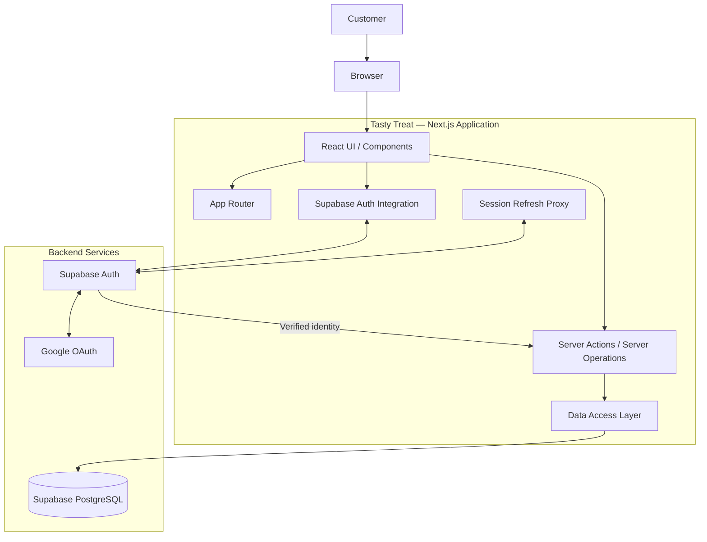
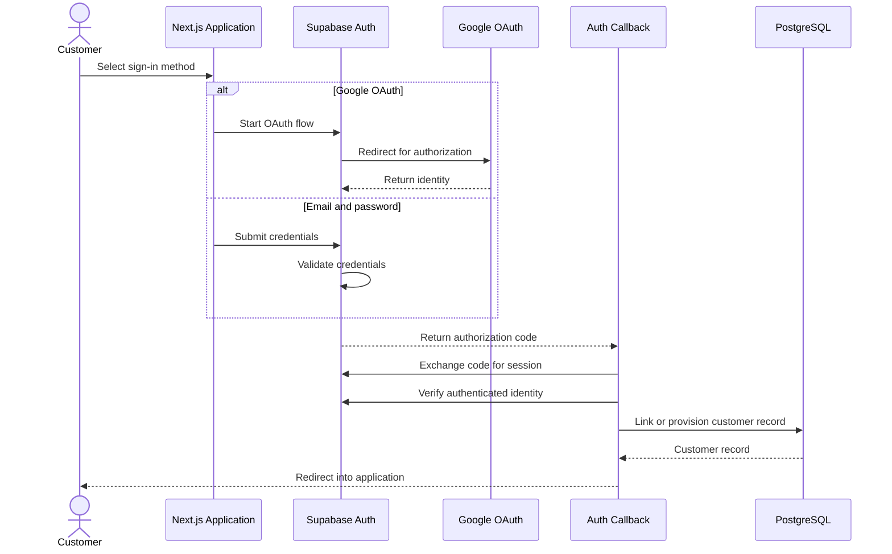
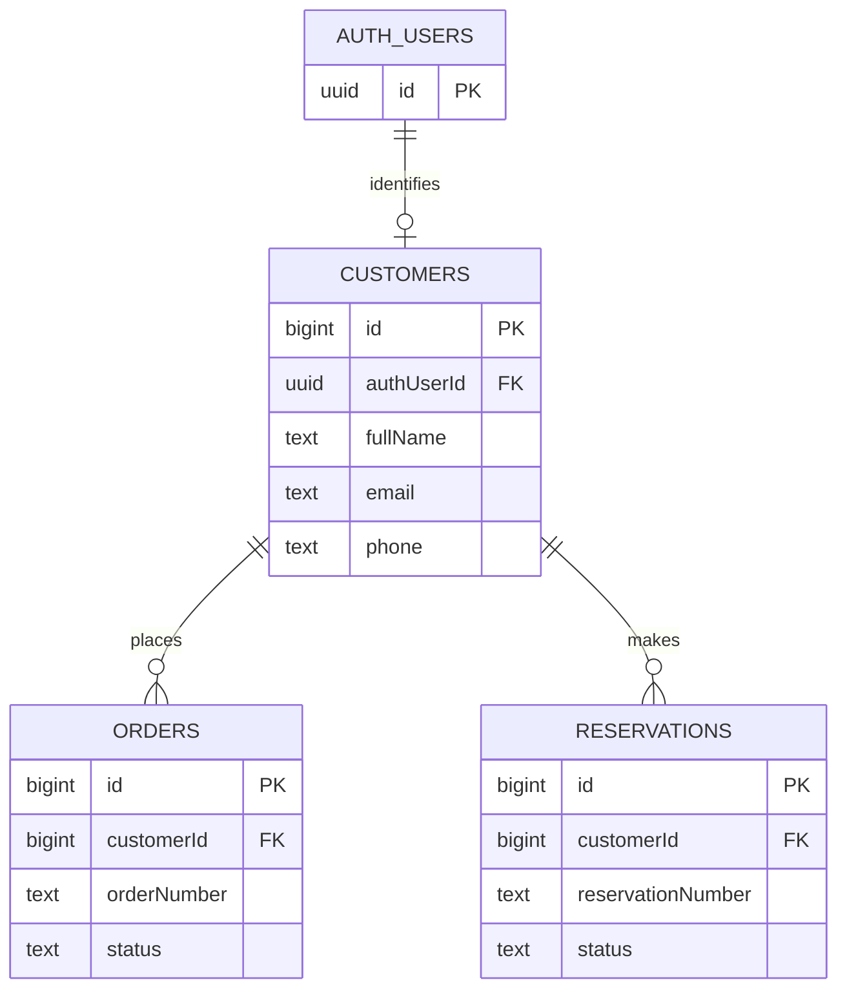
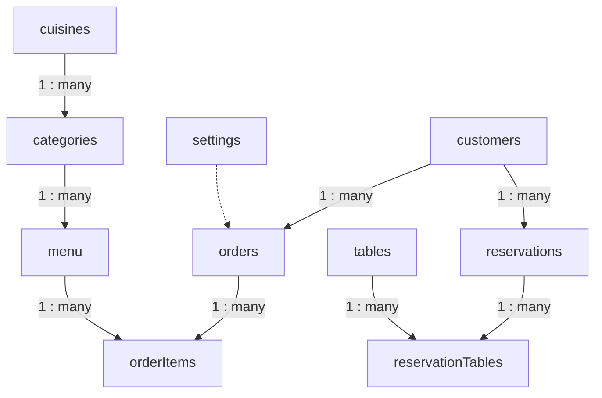
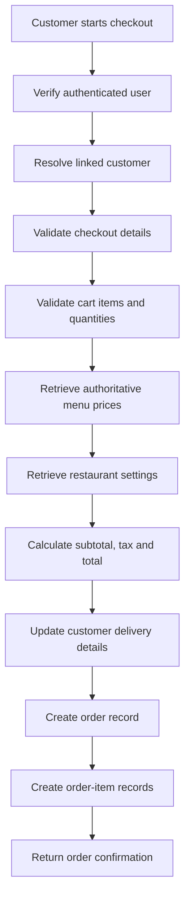
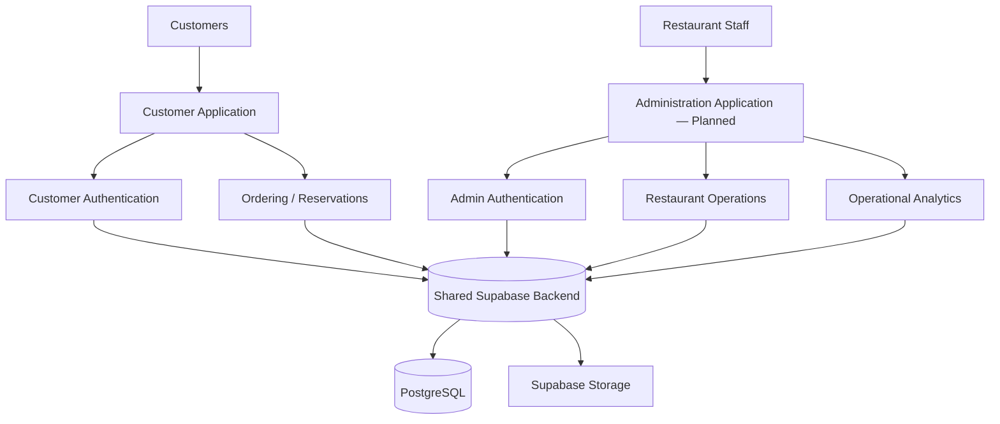

# Tasty Treat

**Restaurant Ordering & Management Platform**

Tasty Treat is a full-stack restaurant platform focused on the customer ordering journey and the operational foundation behind it. The current application brings menu discovery, customer authentication, cart management, checkout, and order workflows together in a cohesive web experience.

The platform is being developed with an emphasis on maintainable application boundaries, database-backed business data, server-side validation, and a foundation for a dedicated restaurant operations application.

> **Development status:** Active development. Features are identified below by their current implementation status. The application is not presented as production-ready; payment processing, operational hardening, deployment, and other planned work remain outstanding.

---

## Product Scope

### Customer experience

- Browse a database-driven menu
- Explore dishes by cuisine and category
- Search and paginate menu items
- Add items to and manage a shopping cart
- Register and sign in
- Authenticate with Google OAuth or email/password
- Recover passwords
- Proceed through checkout
- View order history
- Access reservation-related experiences

### Current implementation

| Capability                                                   | Status                               |
| ------------------------------------------------------------ | ------------------------------------ |
| Responsive customer website                                  | Implemented                          |
| Supabase-backed menu retrieval                               | Implemented                          |
| Cuisine/category filtering, search and pagination            | Implemented                          |
| Cart interactions                                            | Implemented                          |
| Checkout UI                                                  | Implemented                          |
| Order history UI                                             | Implemented                          |
| Supabase Auth integration                                    | Integrated                           |
| Google OAuth                                                 | Integrated                           |
| Email/password authentication                                | Integrated                           |
| Password recovery flow                                       | Integrated                           |
| Auth identity ↔ customer record linkage                      | Integrated                           |
| Server-side checkout validation                              | Implemented                          |
| Server-side order creation                                   | Implemented                          |
| Menu-focused chatbot interface/API                           | Present; further development planned |
| End-to-end authentication and account lifecycle verification | In progress                          |
| Customer profile/account management                          | In progress                          |
| Reservation workflow integration                             | In progress                          |
| Order lifecycle and transaction reliability hardening        | In progress                          |

Integration does not by itself establish production readiness. External payment processing, comprehensive end-to-end verification, and production operational controls are not yet complete.

### Planned platform capabilities

- Dedicated restaurant administration application
- Operational dashboard and analytics
- Menu and inventory management
- Advanced order and reservation management
- Online payment gateway
- Expanded AI-assisted customer support
- Containerized deployment
- CI/CD automation
- Production deployment, monitoring, and operational observability

---

## Technology

| Technology          | Role                                                                                      |
| ------------------- | ----------------------------------------------------------------------------------------- |
| **Next.js 16**      | Full-stack framework, App Router, server rendering and server-side application operations |
| **React 19**        | UI composition and client-side interactions                                               |
| **TypeScript**      | Static typing across application code                                                     |
| **Tailwind CSS 4**  | Utility-first styling and responsive UI implementation                                    |
| **Supabase**        | Backend platform and application data connectivity                                        |
| **Supabase Auth**   | Authentication, identity and session management                                           |
| **PostgreSQL**      | Relational persistence                                                                    |
| **`@supabase/ssr`** | Cookie-aware browser/server Supabase clients                                              |
| **Google OAuth**    | Federated authentication                                                                  |
| **Git / GitHub**    | Version control and source management                                                     |
| **Docker**          | Planned containerization                                                                  |
| **GitHub Actions**  | Planned CI/CD automation                                                                  |

---

## Architecture

The customer application is built around the Next.js application layer. UI components and routes interact with server-side application operations, authentication services, and database-backed data access.



### Application boundaries

| Layer                  | Responsibility                                                 |
| ---------------------- | -------------------------------------------------------------- |
| Presentation           | Customer-facing screens, components and interactions           |
| Routing                | Next.js App Router and page composition                        |
| Authentication         | Supabase Auth integration and session handling                 |
| Application operations | Server Actions, server-side validation and business operations |
| Data access            | Database queries and application data retrieval                |
| Persistence            | PostgreSQL relational data model                               |

These boundaries help keep presentation concerns separate from authentication, business validation, and data access.

---

## Authentication & Identity

Supabase Auth is used for customer authentication. The application integrates Google OAuth and email/password authentication, with password recovery and cookie-based session handling.

### Authentication flow



### Customer identity model

Authentication identity and application customer identity are kept separate:

- Supabase Auth identifies a user with a UUID.
- The application's `customers` table retains its numeric customer ID.
- `customers.authUserId` links the customer record to the Supabase Auth identity.
- Existing customer IDs remain the application-level references used by orders and reservations.

This allows authentication to be integrated without replacing the application's existing relational identifiers.



_`AUTH_USERS` represents Supabase-managed authentication records, not a separately maintained application table._

### Session handling

- Browser authentication uses the publishable Supabase key.
- Server-side authentication uses cookie-based session handling.
- The Next.js proxy refreshes authentication cookies.
- Server-side identity verification uses `supabase.auth.getUser()`.
- Session refresh and authorization are separate concerns; application operations must enforce the relevant authorization and ownership checks.

---

## Database Model

Supabase PostgreSQL provides relational persistence for restaurant, customer, ordering, reservation, and configuration data.

### Core entities

| Entity              | Responsibility                                 |
| ------------------- | ---------------------------------------------- |
| `customers`         | Customer records and authentication linkage    |
| `cuisines`          | Cuisine definitions                            |
| `categories`        | Menu categories associated with cuisines       |
| `menu`              | Dishes, pricing and availability               |
| `orders`            | Customer order records                         |
| `orderItems`        | Items associated with an order                 |
| `reservations`      | Customer reservation records                   |
| `tables`            | Restaurant table information                   |
| `reservationTables` | Reservation-to-table relationships             |
| `settings`          | Restaurant operating and pricing configuration |

### Relationship overview



### Data integrity considerations

- Application-level customer IDs remain numeric.
- Supabase Auth UUIDs are linked through `customers.authUserId`.
- Orders reference customers through `customerId`.
- Order items reference orders and menu items.
- Reservation-table associations use a junction table.
- Checkout validation retrieves menu pricing and availability from the database.
- Checkout totals are calculated server-side using database-backed pricing and restaurant settings.

---

## Order Processing

Checkout is designed to validate submitted data on the server and use authoritative database values rather than trusting client-submitted prices or totals.



### Current checkout safeguards

- Server-side authenticated-user verification
- Customer identity resolved through the authenticated identity
- Input validation for customer and delivery information
- Cart item and quantity validation
- Duplicate-item detection
- Menu availability verification
- Database-backed price retrieval
- Server-side total calculation
- Minimum-order and delivery-fee validation
- Order creation linked to the existing customer record

**Known hardening area:** The current implementation uses best-effort cleanup if order-item insertion fails. Full transaction boundaries and payment reconciliation remain future work.

---

## Security Considerations

Security is treated as an application-wide responsibility.

### Current approach

- Supabase Auth manages customer identity and authentication sessions.
- Server-side operations verify authenticated users.
- Customer records are linked using verified authentication identities.
- Checkout validates user input and database-backed pricing on the server.
- Privileged Supabase credentials are restricted to server-side code.
- Database policies are configured to restrict public access.

### Credential separation

| Credential                 | Purpose                                              | Exposure               |
| -------------------------- | ---------------------------------------------------- | ---------------------- |
| `NEXT_PUBLIC_SUPABASE_URL` | Supabase project endpoint                            | Public configuration   |
| `NEXT_PUBLIC_SUPABASE_KEY` | Publishable key for browser and cookie-based clients | Public publishable key |
| `SUPABASE_KEY`             | Privileged server-side operations                    | Server-only secret     |

The privileged secret must not be exposed through client components, browser requests, public environment variables, or committed source code.

The privileged server-side client can bypass Row Level Security. Therefore, operations using it must verify identity, authorization, and resource ownership in trusted server-side code. Authentication alone does not confer administrative privileges.

---

## Repository Organization

The codebase follows the Next.js App Router structure, with reusable components and shared application logic organized under `src/app`.

```text
tasty-treat-website/
├── public/
├── src/
│   ├── proxy.ts
│   └── app/
│       ├── _components/
│       ├── _lib/
│       │   ├── actions.ts
│       │   ├── apiAuth.ts
│       │   ├── data-service.ts
│       │   ├── supabase-client.ts
│       │   ├── supabase-server.ts
│       │   └── supabase.ts
│       ├── _styles/
│       │   └── globals.css
│       ├── api/
│       │   └── chatbot/
│       ├── auth/
│       │   └── callback/
│       ├── about/
│       ├── cart/
│       ├── checkout/
│       ├── contact/
│       ├── forgot-password/
│       ├── login/
│       ├── menu/
│       ├── orders/
│       ├── reservations/
│       ├── reset-password/
│       ├── layout.tsx
│       ├── page.tsx
│       └── not-found.tsx
├── .env.local                 # Local secrets; never commit
├── next.config.ts
├── package.json
└── README.md
```

_Representative structure; individual files and components may evolve as development continues._

---

## Local Development

### Prerequisites

- Node.js (compatible with the project version)
- npm
- Git
- A Supabase project
- Google OAuth credentials if Google sign-in is enabled

### 1. Clone the repository

```bash
git clone <repository-url>
cd tasty-treat-website
```

### 2. Install dependencies

```bash
npm install
```

### 3. Configure environment variables

Create `.env.local` in the project root:

```env
# Supabase project configuration
SUPABASE_URL=your_supabase_project_url
SUPABASE_KEY=your_supabase_secret_key

# Public Supabase configuration
NEXT_PUBLIC_SUPABASE_URL=your_supabase_project_url
NEXT_PUBLIC_SUPABASE_KEY=your_supabase_publishable_key
```

Never commit actual credentials or `.env.local`. The privileged secret must only be used in server-side code.

### 4. Configure authentication

In the Supabase Dashboard:

1. Enable the authentication providers required by the application.
2. Configure Google OAuth credentials if Google sign-in is used.
3. Set the application Site URL.
4. Add the local callback URL to the allowed redirect URLs.

Local callback URL:

```text
http://localhost:3000/auth/callback
```

For Google OAuth, configure the Supabase-provided callback URL in Google Cloud Console.

### 5. Start development

```bash
npm run dev
```

Open [http://localhost:3000](http://localhost:3000).

### 6. Verify a production build

```bash
npm run build
```

Run the production build locally:

```bash
npm start
```

---

## Engineering Approach

The implementation is developed incrementally with attention to maintainability and correctness.

### Current practices

- Component-based React architecture
- TypeScript
- Next.js App Router conventions
- Tailwind CSS utility-first styling
- Separation of presentation and server-side operations
- Reusable data-access functions
- Server-side input validation
- Database-backed pricing and availability validation
- Environment-based configuration
- Git version control
- Supabase authentication and session handling

### Engineering work planned

- Automated tests and expanded test coverage
- Stronger database transaction boundaries
- Expanded authorization and ownership policies
- Structured application logging
- Docker containerization
- GitHub Actions build/check pipelines
- Deployment automation
- Production monitoring and error reporting

---

## Roadmap

| Workstream                            | Status                                    |
| ------------------------------------- | ----------------------------------------- |
| Customer website and responsive UI    | Implemented                               |
| Database-backed menu                  | Implemented                               |
| Cart experience                       | Implemented                               |
| Authentication integration            | Integrated; end-to-end validation ongoing |
| Checkout and order creation           | Implemented; hardening ongoing            |
| Customer account/profile management   | In progress                               |
| Reservation workflow                  | In progress                               |
| Online payments                       | Planned                                   |
| Restaurant administration application | Planned                                   |
| Operational analytics                 | Planned                                   |
| Advanced AI customer support          | Planned                                   |
| Docker workflow                       | Planned                                   |
| CI/CD automation                      | Planned                                   |
| Production deployment and monitoring  | Planned                                   |

---

## Target Platform Direction

The longer-term architecture is a pair of application experiences connected to shared backend services:

1. **Customer application** — menu discovery, authentication, ordering, reservations, and customer account functionality.
2. **Restaurant administration application** — operational management, menu and order management, reservations, and analytics.



The administration application is a planned extension, not a completed component. Customer and administrative access will require explicitly separated authorization policies and server-side permission checks.

---

## Ownership & Intellectual Property

**Tasty Treat and its source code are independently developed and owned by the project author.**

Copyright notice:

> Copyright © 2026 Ashwin. All rights reserved.

Unless expressly authorized in writing by the copyright owner, no permission is granted to copy, reproduce, redistribute, publish, modify, create derivative works from, sublicense, sell, commercially exploit, or otherwise use this source code or substantial portions of this project.

The repository may be publicly viewable for review purposes. **Public visibility does not grant permission to reuse, copy, modify, redistribute, or claim this project or its code as another person's work.**

Unauthorized use, reproduction, distribution, or misrepresentation of authorship is prohibited. Contributions, third-party dependencies, and other materials remain subject to their respective terms and licenses.

This notice is intended to communicate the project's ownership and restrictions; it is not a substitute for jurisdiction-specific legal advice. For stronger and clearer enforceability, the repository should include a separate proprietary `LICENSE` file reviewed for the applicable jurisdiction and intended commercial use.

---

## License

**Proprietary — All Rights Reserved**

No open-source license is granted for this repository. Use, copying, modification, distribution, or commercial exploitation requires prior written permission from the copyright owner.

See the **Ownership & Intellectual Property** section above.

---

<div align="center">

**Tasty Treat**

_Good food. Great moments._

</div>
